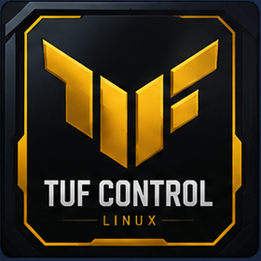

# 🛡️ TUF Control Linux (v0.5)

<p align="center">
  
</p>

<p align="center">
  <b>Centro de control ligero, moderno y seguro para portátiles ASUS TUF Gaming en Linux.</b><br>
  <i>Diseñado especialmente para ASUS TUF F15 (FX506HC) con Intel Core i5-11400H y NVIDIA GeForce RTX 3050 en Nobara / Fedora KDE.</i>
</p>

<p align="center">
  
  
  
  
  
</p>

---

## 🌟 Características Principales

### 🎨 Control Intuitivo de Iluminación RGB (ASUS Aura)
* **Paleta de 12 colores rápidos:** Selección inmediata con un solo clic (*Rojo TUF, Cian ASUS, Naranja Fuego, Verde Neón, Ámbar, Azul Eléctrico, Púrpura Aura, Blanco Frío, etc.*).
* **Deslizadores interactivos R, G, B (0-255):** Ajuste fino del color con previsualización en tiempo real y código hexadecimal automático.
* **Control de brillo y efectos:** Modos *Estático, Respiración, Ciclo Arcoíris, Onda y Pulso*, con selección de brillo (*Apagado, Bajo, Medio, Alto*).

### 📌 Integración con la Bandeja del Sistema (System Tray)
* **Minimización inteligente:** Al cerrar la ventana principal, la aplicación se oculta en la barra de tareas de KDE sin interrumpir el monitoreo ni los perfiles.
* **Información en vivo:** Pasa el cursor por el icono para ver temperaturas de CPU y GPU, perfil activo y estado de la batería.
* **Menú contextual rápido (clic derecho):**
  * Cambiar perfiles de energía (*Silencioso, Equilibrado, Turbo*).
  * Activar o desactivar *Intel Turbo Boost*.
  * Cambiar la pantalla entre *60 Hz* y *144 Hz*.
  * Abrir la ventana o salir de la aplicación.

### 🔋 Protección y Salud de la Batería
* **Presets rápidos de 1 clic:**
  * **🛡 60% (Máxima Vida Útil):** Para cuando juegas o trabajas conectado continuamente a la corriente.
  * **⚖ 80% (Equilibrado Diario):** Excelente balance para proteger la química de la batería en el día a día.
  * **✈ 100% (Modo Viaje):** Carga completa para cuando sales de casa.
* **Límite personalizado:** Ajuste fino mediante control numérico con integración segura vía Polkit (`pkexec`).

### 🖥️ Gestión de Tasa de Refresco (60 Hz vs 144 Hz)
* **Cambio rápido manual:** Botones para alternar la pantalla entre 60 Hz y 144 Hz al instante usando `kscreen-doctor`.
* **Automatización por energía:** Opción para cambiar automáticamente a **60 Hz al desconectar el cargador** (ahorrando hasta un 40% de consumo en pantalla) y regresar a **144 Hz al conectarlo**.

### ⚡ Perfiles ASUS y Automatización Inteligente
* Selección directa de perfiles de ventilación de `asusctl`: *Silencioso (LowPower)*, *Equilibrado (Balanced)* y *Turbo (Performance)*.
* Configuración de presets para aplicar automáticamente perfiles distintos según si el equipo está conectado a la corriente o funcionando con batería.
* **Seguridad garantizada:** No modifica controladores de GPU mux, Secure Boot, GRUB ni voltajes peligrosos.

### 🚀 Persistencia de Intel Turbo Boost
* Activa o desactiva el Turbo Boost directamente a nivel de kernel (`intel_pstate/no_turbo` o `cpufreq/boost`).
* **Servicio systemd dedicado (`tuf-control-boost.service`):** Guarda tu elección en `/etc/tuf-control/boost.state` y la restaura automáticamente tras cada reinicio del equipo.

### 🌡️ Telemetría y Código de Colores Dinámico
* Métricas en tiempo real de temperatura de CPU, GPU NVIDIA, ventiladores en RPM y temperatura de SSD NVMe.
* **Colores de temperatura:**
  * 🟢 **Verde** (< 55 °C): Reposo / Temperatura fresca.
  * 🔵 **Cian** (55 - 74 °C): Carga ligera o moderada.
  * 🟠 **Amarillo / Naranja** (75 - 84 °C): Carga alta.
  * 🔴 **Rojo** (≥ 85 °C): Alerta de temperatura elevada.
  * ⚪ **Gris (Reposo):** Indica claramente cuando la NVIDIA RTX 3050 está suspendida en reposo para máximo ahorro.
* Ventana dedicada de telemetría con gráficos de historial en tiempo real.

---

## 📋 Requisitos del Sistema

* **Distribución:** Nobara Linux, Fedora 39+, Arch Linux u openSUSE con entorno KDE Plasma (Wayland o X11).
* **Hardware soportado:** ASUS TUF Gaming F15 (probado en serie FX506HC, compatible con modelos similares).
* **Dependencias:**
  * `asusctl` y `asusd` (servicios ASUS Linux).
  * `.NET 10 SDK` para la compilación (`dotnet-sdk-10.0`).
  * `lm_sensors` para lectura de sensores (`sensors`).
  * `polkit` para autorizaciones seguras.

---

## 🛠️ Instalación y Compilación

### 1. Clonar el repositorio
```bash
git clone https://github.com/Leitoxd01/Tuf-_Control_F-Linux.git
cd Tuf-_Control_F-Linux
```

### 2. Instalar el SDK de .NET 10 (solo si no lo tienes instalado)
En Nobara / Fedora:
```bash
sudo dnf install -y dotnet-sdk-10.0
```

### 3. Ejecutar el instalador
Ejecuta el script con tu usuario normal (**NO** uses `sudo` para iniciar el script; el instalador te solicitará permisos solo si falta registrar el helper de Boost en systemd):
```bash
chmod +x install.sh
./install.sh
```

El script realizará las siguientes tareas de forma segura:
1. Compila el código en una carpeta temporal aislada.
2. Si la compilación es exitosa, realiza un respaldo de la versión anterior en `~/.local/share/tuf-control.backup-*`.
3. Instala el binario en `~/.local/share/tuf-control/` y crea el lanzador `~/.local/bin/tuf-control`.
4. Integra el acceso directo e icono de alta resolución en el menú de aplicaciones de KDE Plasma.

---

## 💻 Uso

* **Desde el menú de aplicaciones:** Busca **"TUF Control"** y ábrelo o anclalo a tu barra de tareas.
* **Desde la terminal:**
  ```bash
  tuf-control
  ```
* **Comprobar estado del servicio de Turbo Boost:**
  ```bash
  tuf-control-boost status
  systemctl is-enabled tuf-control-boost.service
  ```

---

## 📂 Estructura del Proyecto

```text
├── assets/
│   └── tuf-control.png              # Icono oficial de la aplicación (512x512)
├── scripts/
│   ├── install-system.sh           # Registro de servicios systemd y helpers limitados
│   ├── tuf-control-boost           # Gestor de persistencia de Intel Turbo Boost
│   ├── tuf-control-helper          # Helper Polkit para Turbo Boost y límite de batería
│   └── diagnose.sh                 # Diagnóstico de sensores y hardware ASUS
├── src/
│   └── TufControl/
│       ├── Program.cs              # Punto de entrada y ciclo de vida Avalonia
│       ├── MainWindow.cs           # Ventana principal, bandeja de sistema y métricas
│       ├── LightingWindow.cs       # Selector de color RGB, paleta y deslizadores
│       ├── ProfilesWindow.cs       # Editor de perfiles y automatización
│       ├── AdvancedWindow.cs       # Panel avanzado Fans + Power y Turbo Boost
│       ├── TelemetryWindow.cs      # Monitor de telemetría y gráficos en tiempo real
│       ├── ConfirmWindow.cs        # Diálogos modales de confirmación
│       ├── Hardware.cs             # Detección y comandos sysfs, asusctl y kscreen
│       ├── Settings.cs             # Persistencia JSON (~/.config/tuf-control)
│       ├── Ui.cs                   # Sistema de diseño, tarjetas, fuentes y colores
│       └── TufControl.csproj       # Definición del proyecto y paquetes NuGet
├── systemd/
│   └── tuf-control-boost.service   # Servicio one-shot para restauración de Boost
├── install.sh                      # Instalador inteligente y compilador
└── README.md                       # Documentación
```

---

## 🔄 Restauración o Vuelta Atrás

Si por alguna razón deseas restaurar la versión anterior, el instalador crea automáticamente una copia de seguridad en:
`~/.local/share/tuf-control.backup-[FECHA]/`

Para restaurar manualmente:
```bash
cp -a ~/.local/share/tuf-control.backup-[FECHA]/tuf-control ~/.local/share/tuf-control
```

---

## 📄 Licencia

Este proyecto se distribuye bajo la licencia **GNU General Public License v3.0 (GPL-3.0)**. Consulta el archivo [LICENSE](LICENSE) para más detalles.

---

<p align="center">
  Desarrollado con ❤️ para la comunidad de Linux y usuarios de ASUS TUF Gaming.
</p>
